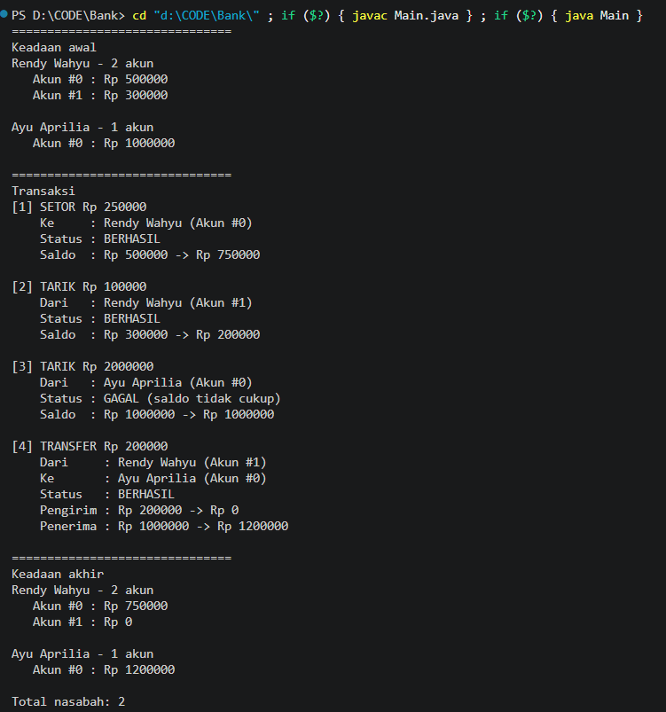

# Latihan PBO 4: Array & ArrayList (Account, Customer, Bank)

## Deskripsi
Implementasi latihan halaman 26-31 materi PBO 4 (Array & ArrayList):
sistem bank sederhana dengan tiga kelas.

| Kelas | Fungsi | Struktur data |
|---|---|---|
| `Account` | menyimpan saldo, setor, tarik | atribut `balance` |
| `Customer` | data nasabah dan akun miliknya | `ArrayList<Account>` |
| `Bank` | menyimpan seluruh nasabah | array `Customer[]` + `numberOfCustomers` |

Selain itu ada:
- `Main.java` : demo otomatis (buat nasabah dan akun, setor, tarik, transfer).

Satu nasabah dapat memiliki lebih dari satu akun, sesuai slide solusi dosen
(`Account[]` atau `ArrayList<Account>`).

## Struktur Proyek
    ├── Account.java
    ├── Customer.java
    ├── Bank.java
    └── Main.java

## Library Tambahan
Tidak ada. Hanya memakai `java.util.ArrayList` dan `java.util.Scanner`
bawaan JDK.

## Screenshot

### Output Main
